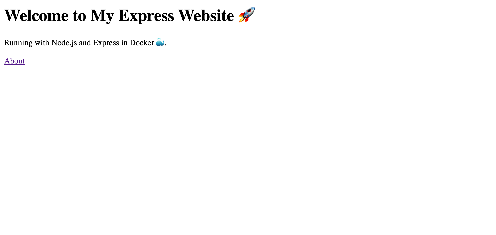
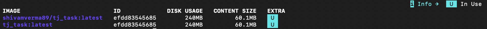
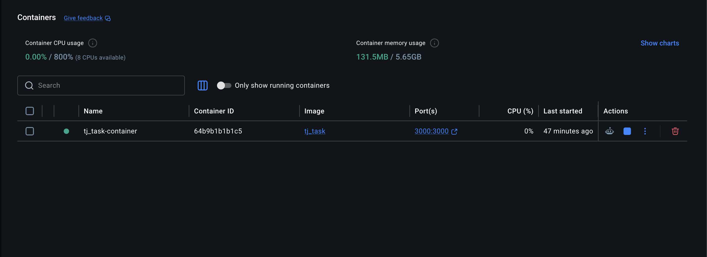
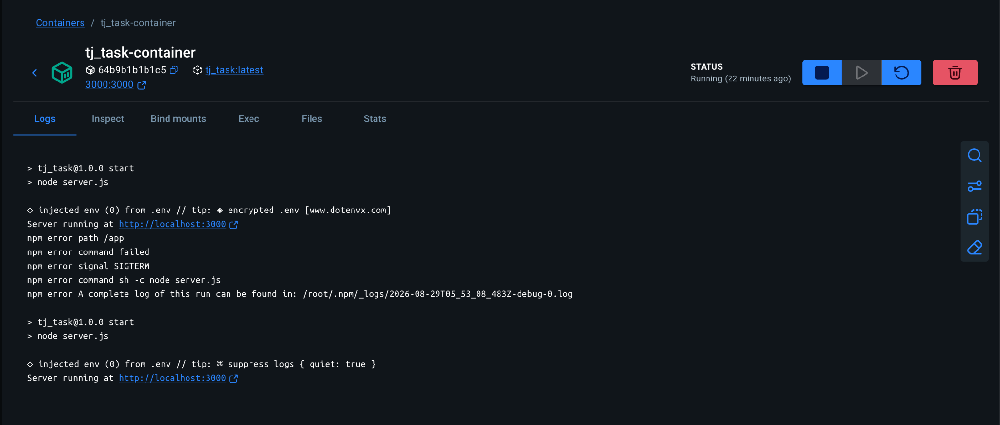
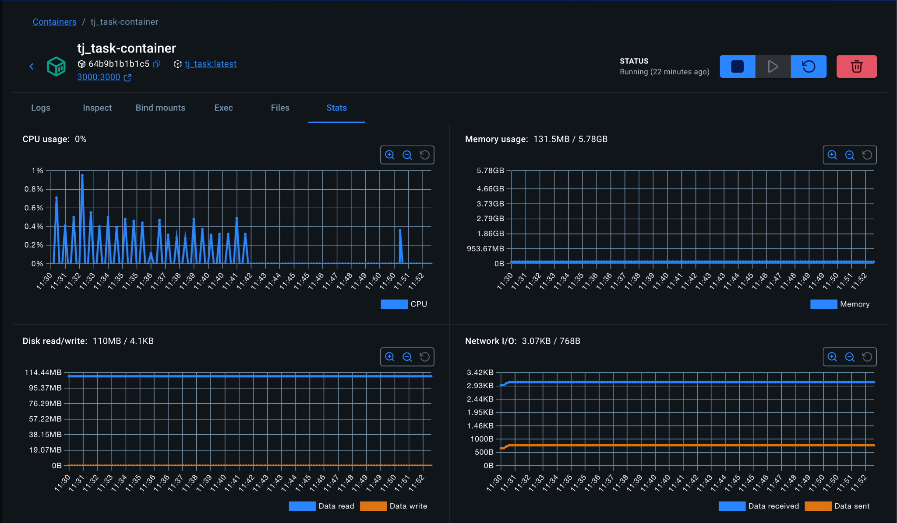
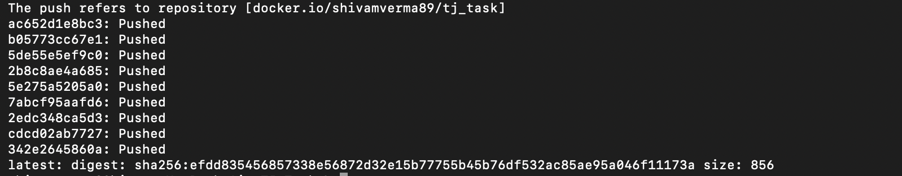
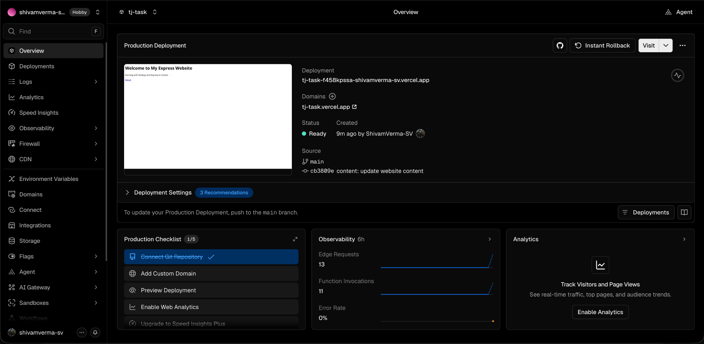

# 🚀 TJ Task — Node.js Express Docker Deployment

A simple **Node.js + Express.js** website built for the **TJ DevOps Task 2026**.

The project demonstrates the complete application workflow from local development and containerization to image publishing and cloud deployment.

- **Node.js + Express.js** — web application
- **Docker** — containerization
- **Docker Hub** — container image registry
- **GitHub** — source-code repository
- **Vercel** — public deployment
- **Environment Variables** — configurable application port

🌐 **Live Website:** https://tj-task.vercel.app/

🐳 **Docker Hub:** https://hub.docker.com/r/shivamverma89/tj_task

💻 **GitHub:** https://github.com/ShivamVerma-SV/TJ_Task

---

## 📸 Application



The homepage provides a simple interface for the Express application and links to the About page.

---

## 📌 Project Overview

The project follows this workflow:

```text
                    ┌─────────────────────┐
                    │  Node.js + Express  │
                    └──────────┬──────────┘
                               │
                ┌──────────────┴──────────────┐
                │                             │
                ▼                             ▼
        ┌───────────────┐              ┌──────────────┐
        │     Docker    │              │    GitHub    │
        └───────┬───────┘              └──────┬───────┘
                │                             │
                ▼                             ▼
        ┌───────────────┐              ┌──────────────┐
        │   Docker Hub  │              │    Vercel    │
        └───────────────┘              └──────┬───────┘
                                              │
                                              ▼
                                        Public Website
```

---

## ✨ Features

- Node.js and Express.js server
- Multiple HTTP routes
- Static frontend served with Express
- Environment-based port configuration
- Docker containerization
- Docker image published to Docker Hub
- Container port mapping
- Docker container lifecycle management
- Docker logs and statistics
- GitHub-based source control
- Public Vercel deployment
- Automatic deployment through GitHub → Vercel

---

## 🛣️ Routes

| Method | Route | Description |
|---|---|---|
| `GET` | `/` | Homepage |
| `GET` | `/about` | About page |
| `GET` | `/hello?name=yourname` | Personalized greeting |
| `GET` | `/time` | Current server time |

### Examples

```text
GET /
GET /about
GET /hello?name=Shivam
GET /time
```

---

## 🧰 Technologies

| Technology | Purpose |
|---|---|
| **Node.js** | JavaScript runtime |
| **Express.js** | Web server framework |
| **Docker** | Application containerization |
| **Docker Hub** | Docker image registry |
| **GitHub** | Source-code hosting and version control |
| **Vercel** | Public application deployment |
| **dotenv** | Environment variable management |

---

## 📂 Project Structure

```text
TJ_Task/
├── public/
│   └── index.html
├── images/
│   ├── image.png
│   ├── docker-build.png
│   ├── docker-container.png
│   ├── docker-logs.png
│   ├── application.png
│   ├── vercel-deployment.png
│   └── docker-hub.png
├── .dockerignore
├── .env
├── .gitignore
├── Dockerfile
├── package.json
├── package-lock.json
├── README.md
└── server.js
```

> `.env` is excluded from version control and is not part of the repository.

---

# 💻 Running Locally

## Install dependencies

```bash
npm install
```

## Environment configuration

The application uses the `PORT` environment variable.

```env
PORT=3000
```

The server reads the configured port and falls back to `3000` when the variable is unavailable:

```js
const PORT = process.env.PORT || 3000;
```

## Start the application

```bash
npm start
```

The application is available at:

```text
http://localhost:3000
```

---

# 🐳 Docker

## Build the image

The application is packaged into a Docker image named `tj-task`.

```bash
docker build -t tj-task .
```

The resulting image can be verified with:

```bash
docker images
```

### Docker Build



The screenshot above shows the Docker image being built and available locally as `tj-task`.

---

## Run the container

The application runs inside a Docker container named `tj-task-container`.

```bash
docker run -d \
  --name tj-task-container \
  -p 3000:3000 \
  tj-task
```

The port mapping exposes the application's container port `3000` on local port `3000`.

```text
localhost:3000
      │
      ▼
Docker Container:3000
```

### Running Docker Container



The Docker Desktop view shows the `tj_task-container` running from the
`tj_task` image with port `3000:3000` mapped to the host.

---

## 📋 Docker Logs

Application logs can be viewed with:

```bash
docker logs tj-task-container
```

For live log output:

```bash
docker logs -f tj-task-container
```

### Docker Logs



The logs confirm that the Express server starts successfully inside the container.

---

## 📊 Docker Container Statistics

Docker provides runtime statistics for the container, including CPU, memory, disk I/O, and network I/O.

```bash
docker stats tj-task-container
```

### Docker Statistics



The statistics demonstrate the runtime resource usage of the container.

---

## 🌐 Dockerized Application

The containerized application is accessible locally through:

```text
http://localhost:3000
```

The available routes are:

```text
http://localhost:3000/
http://localhost:3000/about
http://localhost:3000/hello?name=Shivam
http://localhost:3000/time
```

### Application Homepage


---

## 🛑 Container Lifecycle

The container can be stopped with:

```bash
docker stop tj-task-container
```

and removed with:

```bash
docker rm tj-task-container
```

After making changes, the image can be rebuilt and the container started again:

```bash
docker build -t tj-task .
```

```bash
docker run -d \
  --name tj-task-container \
  -p 3000:3000 \
  tj-task
```

This demonstrates the complete Docker container lifecycle: **build → run → inspect → stop → remove → rebuild → run**.

---

# 🐳 Docker Hub

The Docker image is published to Docker Hub:

**Docker Hub Repository:**  
https://hub.docker.com/r/shivamverma89/tj_task

The published image can be pulled with:

```bash
docker pull shivamverma89/tj_task:latest
```

## Image Publishing

The image is tagged for the Docker Hub repository:

```bash
docker tag tj-task shivamverma89/tj_task:latest
```

and published with:

```bash
docker push shivamverma89/tj_task:latest
```

### Docker Hub Repository



The screenshot above shows the Docker Hub repository containing the published `tj_task` image.

---

# ▲ Vercel Deployment

The application is publicly deployed using Vercel.

🌐 **Production URL:**  
https://tj-task.vercel.app/

The deployed application provides the same Express routes:

```text
/
 /about
 /hello?name=yourname
 /time
```

### Vercel Production Deployment



The deployment is connected to the GitHub repository and the production deployment is marked **Ready**.

---

# 🔐 Environment Variables

The application uses an environment variable to configure the server port.

```env
PORT=3000
```

In `server.js`:

```js
const PORT = process.env.PORT || 3000;
```

The `.env` file is excluded through `.gitignore`:

```gitignore
node_modules/
.env
```

This keeps local environment configuration and private credentials out of the Git repository.

---

# 🔄 Continuous Deployment

The GitHub repository is connected to Vercel.

When a change is pushed to the `main` branch:

```text
GitHub
   │
   │ git push
   ▼
Vercel
   │
   │ automatic deployment
   ▼
Production Website
```

This allows updates to the application to be automatically deployed after changes are pushed to GitHub.

---

# 📸 Project Evidence

The following screenshots document the implementation and deployment:

| Evidence | Screenshot | Description |
|---|---|---|
| Application | `image.png` | Express website homepage |
| Docker Build | `docker-build.png` | Docker image build and local image |
| Docker Container | `docker-container.png` | Running container and port mapping |
| Docker Logs | `docker-logs.png` | Express server logs inside Docker |
| Docker Statistics | `docker-stats.png` | Container resource usage |
| Vercel | `vercel-deployment.png` | Production deployment marked Ready |
| Docker Hub | `docker-hub.png` | Published Docker image |

---

# ✅ Task Requirements

### Node.js Application

- [x] Create a Node.js/Express server
- [x] Add at least two routes
- [x] Implement additional API routes

### Docker

- [x] Create a `Dockerfile`
- [x] Create a `.dockerignore`
- [x] Build a Docker image
- [x] Run the application inside a Docker container
- [x] Map the container port to the local machine
- [x] Stop and remove the container
- [x] Rebuild and run the container
- [x] Check application logs

### Environment Variables

- [x] Use an environment variable
- [x] Keep `.env` out of version control

### Deployment

- [x] Deploy the application using Vercel
- [x] Make the application publicly accessible
- [x] Include the deployed URL in the README
- [x] Publish the Docker image to Docker Hub
- [x] Include Docker setup evidence
- [x] Include running-container evidence
- [x] Include application evidence
- [x] Include Vercel deployment evidence
- [x] Include Docker Hub evidence

### Bonus

- [x] Push an application change to GitHub
- [x] Verify the Vercel deployment updates automatically

---

# 🔗 Project Links

| Resource | Link |
|---|---|
| 🌐 Live Website | https://tj-task.vercel.app/ |
| 💻 GitHub Repository | https://github.com/ShivamVerma-SV/TJ_Task |
| 🐳 Docker Hub | https://hub.docker.com/r/shivamverma89/tj_task |

---

## 👨‍💻 Author

**Shivam Verma**

TJ DevOps Task — 2026

---

⭐ **Node.js → Docker → Docker Hub → GitHub → Vercel**